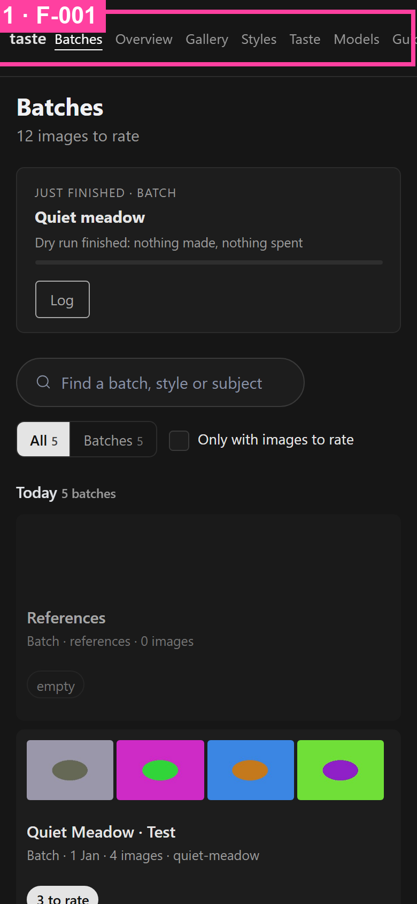
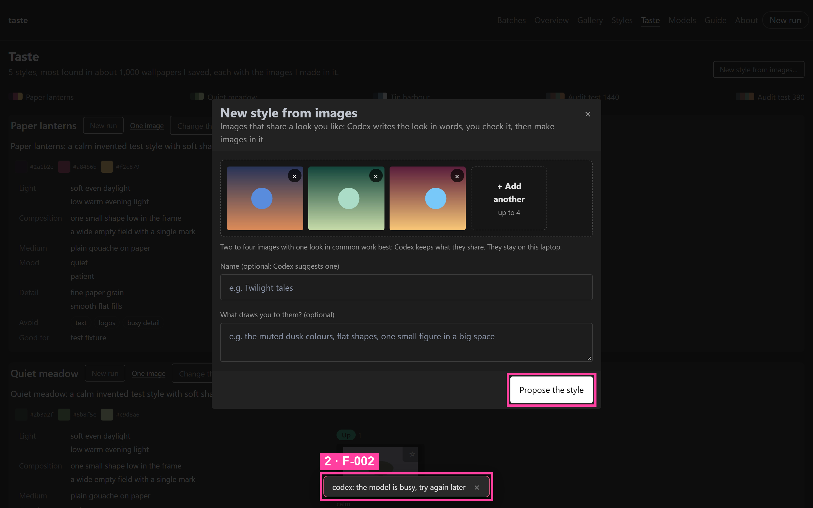
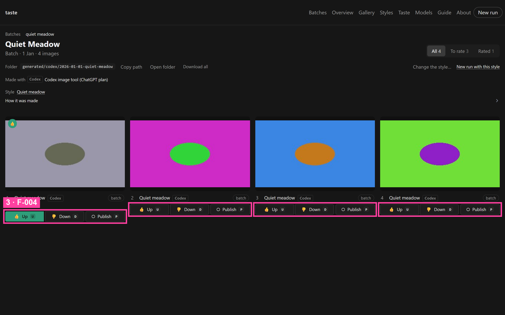
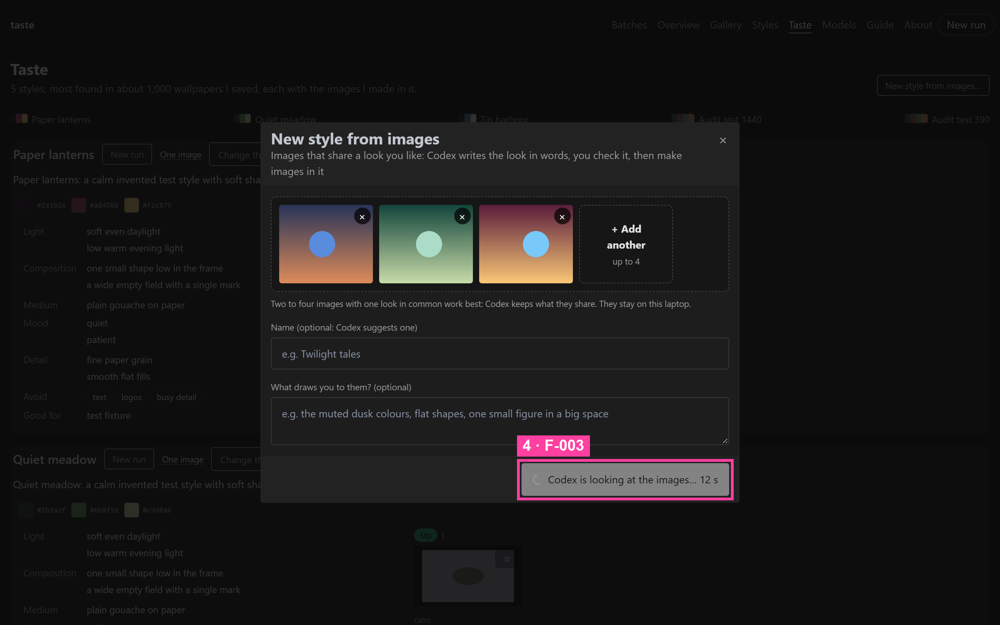
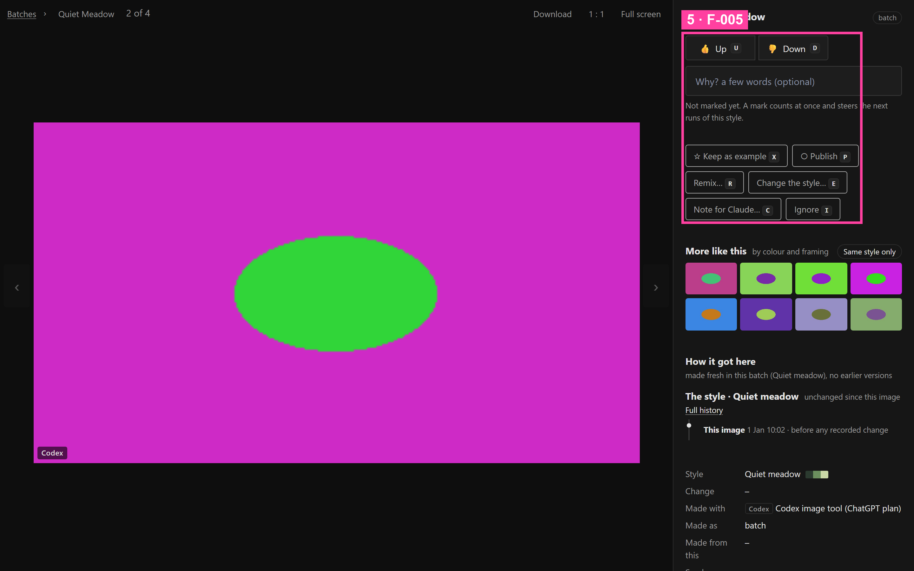

# UX audit: taste web app

28 Nov 2026 · run with the global `ux-audit` skill (`~/.claude/skills/ux-audit/`) on a **fake-data copy** of the app (`scripts/e2e.py --serve`, dry-run mode: no Codex calls, none of Marc's images or ratings). 72 states captured at 1440 and 390 px (deviceScaleFactor 2), axe-core 4.14.1 on each, contrast scan, touch-target scan, timings, Tab walks.

## Summary

| Criterion | Sev 3 – blocks/misleads | Sev 2 – friction | Sev 1 – cosmetic | Findings | Score (Σ severity) |
|---|---:|---:|---:|---:|---:|
| Attention and visual hierarchy | 0 | 1 | 0 | 1 | 2 |
| Cognitive load | 0 | 1 | 0 | 1 | 2 |
| Gestalt grouping | 0 | 1 | 0 | 1 | 2 |
| Feedback and perceived speed | 0 | 1 | 1 | 2 | 3 |
| States | 1 | 2 | 1 | 4 | 8 |
| Copy | 0 | 0 | 2 | 2 | 2 |
| Accessibility | 1 | 3 | 1 | 5 | 10 |
| Design system consistency | 0 | 0 | 2 | 2 | 2 |
| **Total** | **2** | **9** | **7** | **18** | **31** |

Reach: 3 = core flow (extracting a style from images, and rating, which the app is named after), 2 = frequent secondary flow, 1 = rare. Priority = severity × reach. Top 5 = highest priority; ties go to more screens affected, then earlier in the core flow; at most two per criterion.

**In one line:** the extraction flow works and answers fast, but its waiting and failure states are nearly silent, and the phone layout breaks at the header: at 390 px every page is 519 px wide and the main action is off-screen.

**What works (kept as is):** at 1440 px first feedback on every measured click is 40–45 ms; a 12000×12000 image is added in ~0.5 s (shrunk in the browser); every element reached in the Tab walks has a computed focus ring; popups keep typed text and a fresh Codex proposal when you click outside them; the empty Batches state says what to do next.

## Top 5

### 1. Phone width: the header nav forces a 519 px page, New run is off-screen (F-001)

- **Criterion:** Accessibility · severity 3 · reach 3 · priority 9
- **Evidence:** At 390 px the layout viewport becomes 519 px on every page (measured: innerWidth 519, nav scrollWidth 519). The 10 header links don't wrap, so Guide is cut and About and New run are outside the visible area (New run spans x 457–517). In the automated run, 6 taps on dialog-footer and Start buttons at 390 px landed on a neighbouring element because of the zoomed layout.
- **Why:** The product's main action is invisible on a phone, and every page is either zoomed out to 75 % (12.5 px text reads as 9.4 px) or scrolls sideways; WCAG 1.4.10 Reflow fails.
- **Fix:** Below ~760 px collapse the nav into a menu (or a scrollable strip) and pin New run; let `.topbar nav a` wrap.
- **Where:** `app/app.css:815` · full screen: `screens/land-batches-fold-390.png`

### 2. Extraction errors show as a far-away toast in system language, then vanish (F-002)

- **Criterion:** States · severity 3 · reach 3 · priority 9
- **Evidence:** Forced on Propose: 502 → toast "codex: the model is busy, try again later"; 413 → "request too large"; offline → "Failed to fetch". Each toast sits bottom-centre of the screen, away from the button at the dialog's bottom right, with no Retry, and leaves after 8 s. Then the dialog looks exactly as before the click.
- **Why:** Attention is on the button that was just pressed; an error outside that spot is missed, and once it's gone the person thinks nothing happened or that it's still working.
- **Fix:** Show the error inline next to the button, in plain words with the next step, kept until the next try; add Retry.
- **Where:** `app/js/newstyle.js:156` · full screen: `screens/extract-err-502-1440.png`

### 3. Rating buttons and many controls are under 44 px (F-004)

- **Criterion:** Accessibility · severity 2 · reach 3 · priority 6
- **Evidence:** Up / Down / Publish buttons measure 110×29 px in the grid and viewer; toast close 25×20 px; header links 38 px tall; New run 82×31 px. 239 distinct undersized controls were counted at 1440 px across all states.
- **Why:** Rating is the most repeated action in the app; small targets slow every tap (Fitts) and miss on touch or with a tremor.
- **Fix:** Min-height 44 px for .mark-btn, .toast-close and nav links (padding, not larger type).
- **Where:** `app/app.css:213` · full screen: `screens/rate-1-grid-fold-1440.png`

### 4. The only sign of a 30–60 s extraction is a button label with a seconds counter (F-003)

- **Criterion:** Feedback and perceived speed · severity 2 · reach 3 · priority 6
- **Evidence:** During a 45 s held request the dialog body doesn't change. The only feedback is the disabled button label "Codex is looking at the images… 12 s" at the bottom right. There's no expected duration (the code comment says ~30–60 s), no cancel, and the name and notes fields stay editable even though the request was already sent with the old values. First feedback is 42 ms (good).
- **Why:** Past 10 s attention leaves without a sense of how long is left; an open-ended counter makes the wait feel longer than a stepped indicator with an estimate, and edits that silently don't count break trust.
- **Fix:** Move progress into the dialog body: steps (reading images → writing the look → measuring the palette), "usually 30–60 s", Cancel; lock the fields during the wait.
- **Where:** `app/js/newstyle.js:144` · full screen: `screens/extract-3-in-progress-12s-1440.png`

### 5. Viewer panel: nine actions with equal weight compete with the rating (F-005)

- **Criterion:** Attention and visual hierarchy · severity 2 · reach 3 · priority 6
- **Evidence:** The viewer side panel shows Up, Down, Keep as example, Publish, Remix…, Change the style…, Note for Claude…, Ignore (plus Redo, fix the body on a thumbs-down image) as same-size outline buttons, then More like this, history and details: 37 buttons in view at 1440 px. The pressed Down (saturated pink) is the brightest thing on screen after the image.
- **Why:** With equal visual weight the eye has no ranking (Hick); the core loop (look → thumb → next) competes with seven rarer actions every time.
- **Fix:** Keep Up / Down as the one prominent pair; group the rare actions under a quieter "More" row or menu, with their shortcuts kept.
- **Where:** `app/js/viewer.js:187` · full screen: `screens/rate-2-viewer-1440.png`

## Everything else

### Cognitive load

- **F-009 · Remix shows about 48 choices at once** (sev 2, reach 2, priority 4). The Remix dialog shows 4 "Change" chips, ~22 idea chips in 4 groups plus "More ideas (90 more)", 4 closeness options, 7 counts, 10 models, a text box and the cost (counted from the screenshot; 79 buttons on screen including the viewer behind). *Why:* Every option has the same weight, so a quick "more like this" becomes a form; decision time grows with option count (Hick). *Fix:* Show the defaults as one sentence ("3 images, close, Codex · change") and open ideas and models on demand. `app/js/remix.js:114` · `screens/rate-4-remix-1440.png`

### Gestalt grouping

- **F-008 · Disabled Create and its reason sit out of view of the empty field** (sev 2, reach 3, priority 6). With Description emptied, the empty field shows no mark; the only reason ("Needs a description") is in the footer next to the disabled Create button, below the visible part of the dialog (screenshot shows the field, not the hint). *Why:* Cause and effect are in different regions (proximity), so a disabled button reads as broken rather than "fill this in". *Fix:* Mark the empty field inline ("Needed") and keep the dialog footer sticky so button and hint stay in view. `app/js/newstyle.js:198` · `screens/extract-5-missing-field-1440.png`

### Feedback and perceived speed

- **F-016 · Cold load on a slow network: blank page body for ~8 s** (sev 1, reach 1, priority 1). Slow 3G (CDP): first paint (header only) at 8.9 s, content at 17.3 s, nothing in the page body in between, at both widths. The app loads ~26 unbundled ES modules in a chain. *Why:* Local use is fast, so impact is low; but an empty body with no placeholder reads as broken whenever the API is slow (large libraries). *Fix:* A static "Loading batches…" line in #view in index.html, replaced on first render. `app/index.html:12` · `screens/land-slow3g-first-paint-1440.png`

### States

- **F-006 · Creating a style adds an empty "References" batch to Batches** (sev 2, reach 3, priority 6). After Create style, the Batches list gains a row "References · Batch · references · 0 images · empty" at the top (verified in the fake-data copy via /api/batches). The style's reference images are stored in generated/codex/references/, and that folder is listed as a batch. *Why:* An empty item at the top of the main list reads as a broken or lost batch and costs a scan every visit. *Fix:* Leave references/ out of list_batches (is_batch). `scripts/app.py:336` · `screens/newrun-3-started-1440.png`
- **F-010 · Batches load failure: one line, a "server error" toast, no way forward** (sev 2, reach 2, priority 4). Forced 500 on /api/batches: the page shows "Could not load the batches." plus a toast "server error"; no Retry, no heading (axe page-has-heading-one). *Why:* The home page is where every session starts; a dead end with no next step makes a short outage feel like lost data. *Fix:* Say what happened and that the images are safe, offer Retry, keep the page heading. `app/js/batches.js:22` · `screens/land-server-error-1440.png`
- **F-012 · Tiny and extreme-ratio references are accepted silently** (sev 1, reach 3, priority 3). An 8×8 px PNG and a 4000×200 px JPEG are added like any other image, with no hint. A 12000×12000 PNG is added in ~0.5 s (good: shrunk in the browser). *Why:* Codex can't read a look from 8 pixels; the person learns this only after a 30–60 s wait. *Fix:* Note under the tile when the short side is under ~256 px or the ratio is past 1:6. `app/js/newstyle.js:94` · `screens/extract-edge-too-many-odd-tiny-1440.png`

### Copy

- **F-013 · "4 images at most: the first 3 ones added."** (sev 1, reach 3, priority 3). Adding 4 images when 1 is already there shows the toast "4 images at most: the first 3 ones added." The grammar is off, and the message doesn't say that 1 file was left out. *Why:* The person has to work out which file is missing. *Fix:* "Room for 3 more: added the first 3, left out <file name>." `app/js/newstyle.js:98` · `screens/extract-edge-too-many-odd-tiny-1440.png`
- **F-014 · Developer messages shown to the person** (sev 1, reach 2, priority 2). New run shows "Allowance unknown: No usage reading found under ~/.codex/sessions; report usage as unknown." and "Images land in generated/codex/<date>-<name>/ (kept off GitHub)". *Why:* Paths and tool instructions are noise at the moment of deciding to spend allowance; the About page's principle is tech out of sight. *Fix:* "Allowance not known right now" with a link to the details; drop the folder path or put it behind "Where do images go?". `scripts/codex_run.py:537` · `screens/newrun-1-form-fold-1440.png`

### Accessibility

- **F-007 · Grid tiles: the accessible name doesn't contain the visible text** (sev 2, reach 3, priority 6). axe label-content-name-mismatch: 16 nodes on the batch grid (e.g. a[data-name="quiet-meadow-1"]); the tile's aria-label replaces the caption the person sees. *Why:* Voice-control users say what they see ("click Quiet meadow 1") and nothing responds; WCAG 2.5.3. *Fix:* Start the aria-label with the visible caption, or drop it and let the caption name the link. `app/js/grid.js:320` · `screens/rate-1-grid-1440.png`
- **F-011 · Muted and dimmed text below 4.5:1** (sev 2, reach 2, priority 4). axe color-contrast: 18 nodes in 14 states, e.g. small text #5f5f5f on #161616 = 2.83:1. Contrast scan: Styles page off-rows 2.29:1 (opacity), viewer prev/next arrows 2.8:1 (opacity .35), filter counts 3.97:1 (opacity .75), kbd hints 3.8–4.24:1. *Why:* Dimming with opacity makes secondary text drop below legibility instead of just lower in the hierarchy; small text at 2.3–2.8:1 is effectively missing for many eyes. *Fix:* Use one muted colour token that passes 4.5:1 (e.g. #9a9a9a) instead of opacity on text. `app/app.css:202` · `screens/page-styles-1440.png`
- **F-015 · Minor ARIA misuse in dialogs and strips** (sev 1, reach 2, priority 2). axe: aria-prohibited-attr on div[aria-label="Your references"] (6 states, serious); aria-allowed-role, role=listitem on .similar-thumb anchors (50 nodes, minor). *Why:* Screen readers ignore or misreport these names; low impact but cheap to fix. *Fix:* role="group" (or "list" with real items) on the strip; wrap thumbs in li or drop the role. `app/js/newstyle.js:172` · `screens/extract-4-proposal-1440.png`

### Design system consistency

- **F-017 · Hardcoded colours and drifting sizes outside the tokens** (sev 1, reach 2, priority 2). app.css has 121 hex literals (31 distinct) next to its tokens, e.g. #3a3a3a ×14 = --pico-secondary-background, #4a4a4a on .nav-new; 24 distinct font sizes (.72–1rem, seven between .78 and .92rem), 21 gap values, 8 radii incl. both 99px and 999px and 2/3/4px next to .25rem. *Why:* Near-identical values read as accidents and make hierarchy steps unclear; each new screen adds another. *Fix:* Map to a small scale: 4 text sizes, 5 spacings, 2 radii, and colour tokens for every hex. `app/app.css:466` · `screens/land-batches-fold-1440.png`
- **F-018 · Five near-duplicate chip and segmented-control patterns** (sev 1, reach 2, priority 2). .filters (app.css:123), .rseg/.rseg-btn (384), .chips (433), .style-chip (495) and .chip-btn (584), plus .rx-chip in Remix: the same "pick one / pick some" job with different padding, radius and pressed styles (visible in Batches filters, New run shape, Remix closeness and models). *Why:* Same function, different look breaks similarity: people re-learn which state is "on" on every screen. *Fix:* One segmented control (single choice) and one chip (multi choice) with shared pressed styles. `app/app.css:384` · `screens/newrun-1-form-fold-1440.png`

## Measurements

| Interaction | First feedback | Result |
|---|---:|---:|
| cold load, Slow 3G, 1440px | 8888 ms | 17297 ms |
| add 3 images → tiles shown, 1440px | – | 59 ms |
| propose click → first feedback, 1440px | 42 ms | 42 ms |
| propose answer → proposal shown (dry run, after the hold), 1440px | – | 3341 ms |
| add one 12000×12000 PNG → tile shown, 1440px | – | 501 ms |
| thumbs-up click → button pressed, 1440px | 40 ms | 40 ms |
| Start → first feedback, 1440px | 45 ms | 45 ms |
| cold load, Slow 3G, 390px | 8823 ms | 17287 ms |
| add 3 images → tiles shown, 390px | – | 52 ms |
| propose click → first feedback, 390px | 4025 ms | 4025 ms |
| propose answer → proposal shown (dry run, after the hold), 390px | – | 326 ms |
| add one 12000×12000 PNG → tile shown, 390px | – | 462 ms |
| thumbs-up click → button pressed, 390px | 43 ms | 43 ms |
| Start → first feedback, 390px | 4041 ms | 4041 ms |

At 390 px, "propose click" and "Start" read ~4 s: that is the test waiting 4 s for a tap that the zoomed layout blocked (F-001), not the app being slow. "Propose answer" includes the dry run's stand-in script and palette measurement after a deliberate 45 s hold; real Codex takes ~30–60 s and was not measured.

## Method and limits

- Flows: land (Batches, empty, server error, Slow 3G cold load) · extract a style (empty → images added → in progress at 2 and 12 s → proposal → missing field → created; not an image, corrupt file, 12000 px image, too many and odd or tiny images, 502, 413, offline) · rate (grid, viewer, marked, Remix) · New run (form, style picked, started) · a sweep of Overview, Gallery, Styles, Taste, Models, Guide, About.
- Raw data: `raw/states.json` (counts, contrast fails, small targets, axe summary per state), `raw/axe/*.json`, `raw/timings.json`, `raw/extra.json` (Tab walks, blocked taps). Rerun: `run_audit.py`, then `make_top5.py`. `screens/` and `raw/` stay on the laptop (git-ignored); only this report, `findings.json` and `top5/` are in the repo.
- The small-target count includes controls behind an open dialog; findings cite only visible ones.
- Not covered: light theme (the app has none), real Codex latency, screen-reader listening, 320 px reflow, the Gallery large view and style editing dialogs beyond a screenshot.
- Severity and reach are my calls against the rubric; the measurements behind them are in `raw/`.
